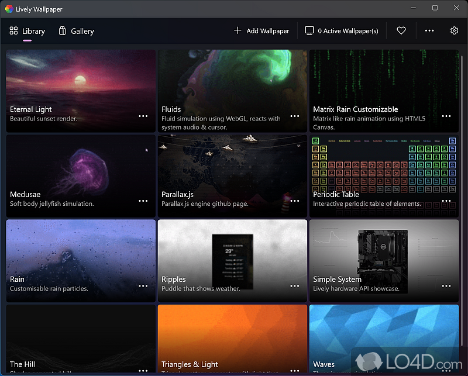
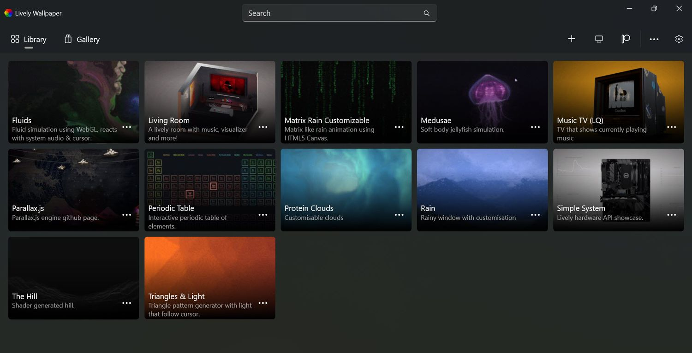
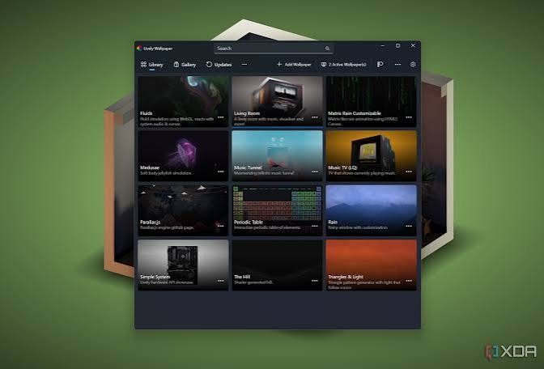

# Lively Wallpaper

Lively Wallpaper is a free desktop app for Windows. It puts a moving picture behind your icons. Live Wallpaper 4K is that picture when the file is a sharp video or a sharp page.

lively wallpaper for pc runs on Windows 10, version 17763 or newer, and on Windows 11. It is not a phone app and it is not a Mac app. lively wallpaper by rocksdanister is this same Windows project, and lively wallpaper open source means the player is published without a paid lock on playback.

A wallpaper here can be an MP4, a GIF, a web page, or a shader. You drop the file on the window, or you paste a page address. The desktop keeps your icons. The background is what changes.

## Features

### Types Of Wallpapers

| Kind | What plays | How heavy it is |
| --- | --- | --- |
| Video or GIF | A file with a fixed size | Steady, depends on the file |
| Web page | HTML, including WebGL | Varies with the page |
| Shader | A small drawing program | Usually lighter than 4K video |
| System view | CPU, RAM, or audio levels | Light if the page is simple |

The contract for a wallpaper object is [IWallpaper.cs](IWallpaper.cs). How a picture is shared across screens is [WallpaperArrangement.cs](WallpaperArrangement.cs).

Video playback for a file wallpaper is [VideoVlcPlayer.cs](video/VideoVlcPlayer.cs). A second video path is `VideoWmfProcess.cs`. A GIF surface is [GifWallpaper.qml](video/GifWallpaper.qml). A window that hosts the frame on Windows is [winwindow.cpp](video/winwindow.cpp).

The shader editor is where a small drawing program becomes the background. The library that keeps those programs is [shaderlibrary.cpp](shader/shaderlibrary.cpp). A shader page is [ShadertoyShader.qml](shader/ShadertoyShader.qml). A depth-style still image is [DepthEstimateWallpaperViewModel.cs](shader/DepthEstimateWallpaperViewModel.cs). Use it when you want a picture to move a little. Skip it when you only wanted a video.

### Screensavers

Any wallpaper can also be the screensaver. The Windows idle screen is the same picture, not a second download. The settings page is [SettingsScreensaverViewModel.cs](screen/SettingsScreensaverViewModel.cs). Layout for that idle screen is `ScreensaverLayoutViewModel.cs`.

Set a short idle time if you want the desktop to go quiet. Set a long one if you only want the wallpaper while you work.

### Automation

The app can take a command to change the wallpaper, pause it, or show the screensaver. That is for a script you already trust. It does not browse the web for you and it does not install a codec pack.

### Lively API

Wallpapers can ask for sound levels and for machine stats. Audio levels are [NAudioVisualizerService.cs](audio/NAudioVisualizerService.cs). GPU numbers for a system page are [gpu.cpp](stats/gpu.cpp). Memory numbers sit beside them in `ram.cpp`.

A wallpaper that reacts to music should stay cheap. A full 4K video plus a heavy page on two screens will fight a game. Pick one busy wallpaper, not three.

### Machine Learning

A depth pass on a still picture is optional. It is heavier than a looped video of the same picture. If the fan spins up while the desktop is idle, turn that effect off and keep the plain image.

### More Features

- Drop an MP4 or a GIF to set it.
- Paste a web address, including a shader page.
- Drag a file from a folder you already have.
- Keep a different wallpaper on each screen, or span one picture.
- Pause when a fullscreen game or app is in front.

Adding a wallpaper from the library page is `AddWallpaperViewModel.cs`.

### Performance

Playback is meant to pause when a fullscreen game or app is in front, so the desktop is not spending the GPU twice. You can also pause on battery. A remote desktop session should not keep a 4K loop running.

If a laptop gets warm on the desktop, the wallpaper is too heavy. Use a shorter video, a GIF, or a simple shader. `lightning.frag` and `water.frag` are small drawing programs. They are not an excuse to stack three videos.

## Key Features

- MP4 and GIF behind the icons.
- Web and WebGL pages as the background.
- A screensaver that reuses the wallpaper you already chose.
- Per-screen or spanned layouts.
- Audio and system numbers for a wallpaper that wants them.
- A pause rule for fullscreen apps.

The web host is [WebWebView2.cs](web/WebWebView2.cs). The other web host is [WebCefSharpProcess.cs](web/WebCefSharpProcess.cs). Page checks sit in `WebContentUtil.cs`.

## Content Creation

You do not need a new project to set a video. Drop the file. For a page, a single HTML file with its images in the same folder is enough. Keep the page light: one canvas, not a shop.

A widget on top of the wallpaper is separate from the wallpaper. The widget window is [widgetwindow.cpp](screen/widgetwindow.cpp). Do not cover the whole screen with a widget or you will hide the wallpaper you just set.

## Platform support

| Piece | Windows 10 | Windows 11 |
| --- | --- | --- |
| Video wallpaper | Yes, 17763 or newer | Yes |
| Web wallpaper | Yes | Yes |
| Screensaver | Yes | Yes |
| Several monitors | Yes | Yes |
| Mac desktop | No | No |

This table is the PC app. A phone store listing with a similar name is a different product.

The monitor grid is the layout of your screens. One row can span. Two rows can each have their own file. The display list is [DisplayManager.cs](monitor/DisplayManager.cs). One screen record is [DisplayMonitor.cs](monitor/DisplayMonitor.cs). The layout page is `WallpaperLayoutViewModel.cs`.

4 GB of RAM is the floor. 8 GB is the comfortable size. DirectX 9 is the floor for the picture. DirectX 11 is the comfortable one. Live Wallpaper 4K needs the comfortable machine if the file is really 4K.

## Grab the build

One package. The publisher site, or the Microsoft Store. One button.

lively wallpaper for pc is that Windows build. Do not take a random archive that added a toolbar.

### First session

Drop one short MP4. Confirm it sits behind the icons. Then try a second screen, or a pause rule. Leave shaders and depth until the video already looks right.

If a fullscreen game stutters, check that playback is set to pause. Then quit the game and see the wallpaper return.

## Support

#### Programmer

The tree is split by job: `video`, `web`, `shader`, `monitor`, `audio`, `screen`, `stats`. Read the player you care about. A wallpaper file is not in these sources.

#### Designer

The preview should show the real crop. A 4K frame that looks fine in a tiny preview can be too busy on a 1080p screen. Check both.

#### Localization

Menus ship in more than one language. The wallpaper you import does not. A page in another language is still just a page.

#### Suggestions & Bug report

Name the Windows version, the kind of wallpaper, and whether one screen or several were in use. "It is black" is not enough. Say if sound was supposed to move the picture.

#### Spread the word

Tell someone the app is free. Do not hand them a repack.

## License

The player is free to use. lively wallpaper open source is the published project, not a key. The notice file in the tree is not a second download and not a crack.

## General Contributing

Fixes belong with the publisher project. This page does not take a patch by mail. Translate, or describe a bug with the wallpaper type, and keep the sample small.

## Frequently Asked Questions

Why is a video wallpaper hot or loud?

The file is too heavy for that PC. Try a shorter clip, a lower size, or a shader. Pause on battery. A 4K loop on two screens is a lot of decode for a laptop.

Can each monitor have its own wallpaper?

Yes. Span one file, or set a different file per screen. Apply the layout before you judge a missing picture. A screen with no assignment stays on the normal desktop.

## Related Questions

### Can you set live wallpaper on PC?

Yes. Lively Wallpaper is the Windows app for that. Drop a video, a GIF, or a page. The icons stay. The background moves. Live Wallpaper 4K is the same app with a sharp file, not a different installer.

### Is Lively wallpaper available on Mac?

Not this desktop app. lively wallpaper for pc is Windows 10 and Windows 11. A phone listing with a similar name is not the Windows player on this page.

### What is the best free alternative to Wallpaper Engine for Windows?

This page is Lively Wallpaper. It is free, it is open source, and it plays video, web, and shaders on the desktop. Other wallpaper apps exist. Use this one when you want that Windows player from the publisher.

### Is lively wallpaper the same as wallpaper engine?

No. They are different apps. Lively Wallpaper is the free open-source Windows player described here. It pauses for fullscreen games, it can cover several monitors, and it takes your own MP4 or page. Do not expect one app's store to open inside the other.

## Related Search Terms

Live Wallpaper 4K, Lively Wallpaper, lively wallpaper by rocksdanister, lively wallpaper open source, lively wallpaper for pc, Topics: live-wallpaper, wallpaper, windows, screensavers, winui, csharp, desktop, video, webgl, multi-monitor, shaders, mpv
